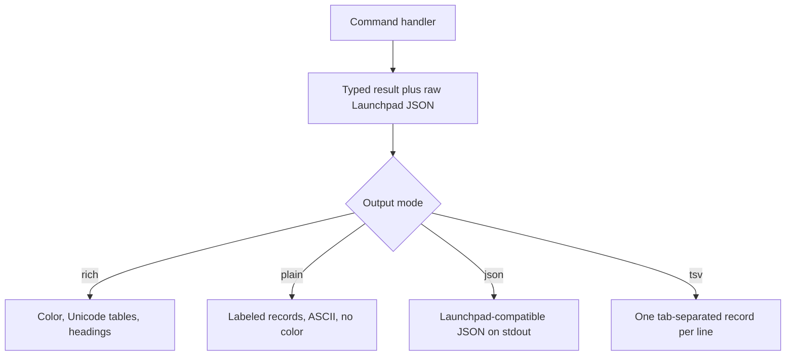

# Plan: Improving the lpcli Command-Line Interface

- **Date:** 2026-11-16
- **Status:** Phases 0 and 1 implemented in lpcli 0.5.0 (2026-11-17);
  Phase 2 implemented pending manual Orca and BRLTTY desktop testing;
  Phases 3 to 4 proposed
- **Baseline:** lpcli 0.4.0
- **Target release:** lpcli 0.5.0 (a SemVer-incompatible release) for
  Phases 0 and 1
- **Scope:** `src/bin/lpcli.rs`, `src/bin/lpcli/`, the library modules that return
  Launchpad entries, `src/download.rs`, `README.md`, `SKILL.md`, and the tests.

## Goals

Make lpcli:

1. **Beautiful and easy to read** for sighted users.
2. **Accessible and pleasant** for users of screen readers and other
   assistive technology.
3. **Terse and efficient** for LLMs, agents, and scripts.

## Current state

| Finding | Evidence | Who it affects |
|---|---|---|
| Output is printed directly from each command handler, with no shared output layer | `src/bin/lpcli.rs` has about 285 `println!` calls and 38 tables | Everyone; there is no single place to switch styles |
| Only one command has machine-readable output | `bug remote-bug-trackers --json`, which prints a bare JSON array (removed in 0.5.0; see D1) | Agents |
| The skill tells agents to count bugs with `wc -l` | `SKILL.md`; table borders and wrapped rows make the count wrong | Agents |
| Tables always use box-drawing characters | `UTF8_FULL_CONDENSED`; the stacked layout is used only at very narrow widths | Screen-reader users (borders are announced) |
| Decorative symbols and an emoji | `✓`, `✗`, `●`, `ℹ`, `~`, `📎`, and 13 lines of `─` repeated 60 times | Screen-reader users; agents (wasted tokens) |
| An em dash stands for a missing value | Used in 85 places | Read aloud as "em dash"; ambiguous for agents |
| Hierarchy is shown only by indentation | Series rows in the bug tasks table are indented by four spaces | Screen-reader users |
| Raw API URLs are shown | Comment authors are shown as full `owner_link` URLs | Everyone |
| Every failure exits with code 1 | `main()` | Agents and scripts |
| Partial failures exit with code 0 | Downloads that partly fail; some multi-series operations | Agents and scripts |
| Download progress bars redraw in place | `indicatif` in `src/download.rs` | Screen-reader users (repeated announcements) |
| Library types keep only some Launchpad fields | Typed structs such as `BugTask` | JSON fidelity |
| Interactive prompts already behave well | Prompts go to stderr, PINs are not echoed, interactive steps check for a terminal | Keep this behavior |

## Decisions

| # | Question | Decision |
|---|---|---|
| D1 | Output mode names, and whether to keep `--json` | Use `rich`, `plain`, `json`, and `tsv`. **Remove `--json` completely in 0.5.0**, with no deprecation period, alias, or special error. `README.md`, `SKILL.md`, and `CHANGELOG.md` explain that `--json` has been replaced by `--format json`. JSON output uses the Launchpad collection shape from 0.5.0 onwards. |
| D2 | Is the JSON output a stable contract? | Yes. lpcli is seeing broad adoption, so JSON output is a **versioned public contract**. It matches the JSON returned by the [Launchpad web API](https://api.launchpad.net/devel.html) as closely as possible, so lpcli output stays compatible with Launchpad clients. |
| D3 | Snapshot testing | Add the `insta` crate as a dev-dependency for snapshot tests. |
| D4 | New exit codes | Introduce them in Phase 1, as listed under "Rollout phases". |
| D5 | Release and versioning | Ship the breaking changes together in **0.5.0**. For a `0.y.z` crate, Cargo's SemVer rules treat a change of the left-most non-zero component as incompatible, so 0.4.x and 0.5.0 are SemVer-incompatible. The improved output formats are worth these small breaking changes. |
| D6 | Release notes | Record user-visible changes in `CHANGELOG.md`, following the [Keep a Changelog](https://keepachangelog.com/en/1.1.0/) format. Unreleased changes go under `## [Unreleased]` until 0.5.0 is tagged. |

## Guiding principles

1. **Separate data from presentation.** Each command produces a typed result
   that a renderer turns into output. Reusable API code stays in the library;
   rendering stays in the binary, as `AGENTS.md` requires.
2. **Never rely on color or symbols alone.** Every status also has a word,
   such as "OK", "Failed", or "Warning".
3. **Results go to stdout. Prompts, progress, warnings, and diagnostics go to
   stderr.**
4. **Pick sensible defaults automatically, and always allow an explicit
   override.**
5. **Preserve existing security boundaries.** Output changes must never weaken
   the `--public` behavior, credential redaction, or hardware-key prompting.

## Target design

### Output modes



| Mode | Used by default when | What it looks like |
|---|---|---|
| `rich` | Nothing else applies | The current look, polished. Color is turned off automatically when stdout is not a terminal. |
| `plain` | The accessibility setting is on, `TERM=dumb`, or `--format plain` is given | No color or box drawing, words instead of symbols, labeled records |
| `json` | `--format json` | Launchpad-compatible JSON; errors are also JSON |
| `tsv` | `--format tsv` | A header row, then one record per line |

**How the mode is chosen**, from highest priority to lowest:

1. The `--format` option.
2. The `LPCLI_FORMAT` environment variable.
3. The `display.format` setting in `config.toml`.
4. Automatic detection, as in the table above.

**Color** follows the usual conventions:

- `--color auto|always|never`, plus the `NO_COLOR` and `CLICOLOR_FORCE`
  environment variables.
- Color is decided separately for stdout and stderr.
- The renderer receives an explicit style setting. It does not rely on the
  global override in the `colored` crate, which would make parallel tests
  interfere with each other.

### JSON contract (D2)

**Entries.** When a command returns one Launchpad object, the JSON output is
that object's Launchpad representation. Field names, nesting, `null` values,
`*_link` fields, `self_link`, `web_link`, `http_etag`, and
`resource_type_link` are kept exactly as Launchpad returns them.

**Collections.** List output uses Launchpad's collection shape:
`total_size`, `start`, and `entries`.

- When lpcli has fetched every page, it omits `next_collection_link`.
- When `--limit` cuts the list short, it keeps `next_collection_link` so the
  caller can continue.
- Some Launchpad collections return `total_size_link` instead of
  `total_size`. When lpcli does not know the total, it passes
  `total_size_link` through rather than inventing a count.

**Values.** Launchpad values are never reformatted. This includes timestamps,
enum display strings such as `Fix Released`, and link URLs.

**Preserving the original JSON.** The library's Rust types keep only a subset
of each object's fields, and turning them back into JSON could change values
such as date formats. JSON output must therefore come from the original
Launchpad JSON, not from the typed structs. Phase 0 chooses one of these
approaches and records the choice in a decision record:

- **Recommended:** the library returns the original JSON alongside the typed
  value, for example as a `Raw<T>` wrapper with `value: T` and
  `raw: serde_json::Value`, or as matching functions that return the original
  JSON.
- **Alternative:** add a `#[serde(flatten)] extra` map to each type. This is
  simpler, but it changes public library types and still re-encodes the
  fields lpcli does model.

The typed values continue to drive the `rich`, `plain`, and `tsv` output.

**Combined commands.** Some commands combine several requests. For example,
`bug show` fetches a bug, its tasks, and its attachments. Their JSON output is
an lpcli-defined object whose members are unmodified Launchpad entries or
collections, named after Launchpad's link names, for example `bug`,
`bug_tasks`, and `attachments`. Values that lpcli works out itself, such as
resolved attachment download URLs, go under a separate `lpcli` member. They
are never added to Launchpad entries.

**Mutations.** Commands that create or change something output the entry
Launchpad returns, or the entry lpcli fetches from the reported location
afterwards. With `--quiet`, they print only that entry's `self_link`.

**Errors.** Launchpad returns errors as plain text, so there is no Launchpad
shape to match. In JSON mode, lpcli writes this object to stderr:

```json
{"error": {"kind": "not_found", "message": "...", "hint": "...", "http_status": 404}}
```

Error output must never contain credentials, grant secrets, PINs, assertions,
or OAuth headers.

**Field selection.** `--fields` uses Launchpad attribute names. It drops other
fields from each entry, keeps the collection shape, and keeps the requested
fields in Launchpad's representation.

**Versioning.**

- The contract covers the JSON shapes described above, lpcli-defined
  members such as combined-command keys, the `lpcli` object, and the error
  object, and the meaning of exit codes.
- Within one version of the contract, changes may only add things. Renaming
  or removing an lpcli-defined key, or changing the meaning of an exit code,
  requires a new contract version.
- The current contract version is documented and reported by a
  `lpcli schema` command, without adding fields to Launchpad entries. A later
  version can be selected explicitly, and the previous version stays
  available for at least one minor release.
- The contract is described in a new `docs/json-output.md`. Publishing
  machine-readable JSON Schema files is an optional follow-up.

**Upstream changes (risk).** lpcli talks to Launchpad's `devel` API, which can
change without warning. Fields that come from Launchpad follow Launchpad's own
changes. lpcli promises not to rename or remove those fields itself. The
contract documentation states this limit, and the project may later decide
whether to support pinning a stable Launchpad API version.

### Removing `--json` (D1)

The goal is to move users to `--format json` as soon as possible, so there is
no deprecation period, no alias, and no special handling.

**Today:** only `bug remote-bug-trackers` accepts `--json`. It prints a bare
JSON array sorted by tracker name.

**After the change (0.5.0):**

- The `--json` option is deleted from `bug remote-bug-trackers`, the only
  command that has it. No command accepts `--json`, and none gains a hidden
  `--json` argument or a custom error for it.
- Passing `--json` produces clap's normal "unexpected argument" usage error,
  with exit code 2. It fails before configuration loading, authentication,
  any security-key prompt, or any network request.
- The replacement is documented instead of enforced in code:
  - `README.md` explains that `--json` has been replaced by `--format json`,
    with before-and-after examples and the new output shape.
  - `SKILL.md` replaces its `--json` example with `--format json`, and tells
    agents that `--json` is no longer accepted.
  - `CHANGELOG.md` lists the removal under "Removed" for 0.5.0, with
    migration steps.
- `bug remote-bug-trackers --format json` prints the collection shape:

  ```json
  {"total_size": 2, "start": 0, "entries": [{"name": "debbugs", "...": "..."}]}
  ```

  Entries are the unmodified Launchpad `bug_tracker` representations, in the
  order Launchpad returned them. The old output sorted them by name.

**Client-side filtering.** `bug remote-bug-trackers --search` filters
Launchpad's results locally, so no Launchpad link can continue a filtered
list. For this kind of collection:

- `total_size` is the number of matches, and is present only when every page
  was scanned.
- When `--limit` stops the scan early, `total_size` is omitted, because the
  true total is unknown. `next_collection_link` is also omitted, because it
  would point to unfiltered results.
- `docs/json-output.md` documents this behavior.

**Implementation notes:**

- Delete the `json` field from `BugCommand::RemoteBugTrackers` and its
  `--json` help text.
- Remove the bare-array serializer (`trackers_to_json`) and its tests,
  including `cli_remote_bug_trackers_json_output_flag`. Replace them with
  tests for the collection-shape output.
- Add a parser test confirming that `--json` is rejected as an unknown
  argument.

**Migration:**

| Before (0.4.x) | After (0.5.0) |
|---|---|
| `lpcli bug remote-bug-trackers --json` | `lpcli bug remote-bug-trackers --format json` |
| Top-level JSON array, sorted by name | `{"total_size", "start", "entries"}`, in Launchpad order |
| `jq '.[].name'` | `jq '.entries[].name'` |

The existing documentation-example tests parse every `lpcli` example in
`README.md` and `AGENTS.md`. Mention `--json` only in prose, tables, or
non-shell code blocks, never as a runnable `lpcli` command in a `bash` or
`sh` block. Phase 0 extended the same tests to cover `SKILL.md`.

**Timing:** the `README.md` and `SKILL.md` changes ship in the same change
as `--format json`. Documenting `--format json` earlier would describe an
option that does not exist yet, and the documentation-example tests would
fail.

### Exit codes (D4)

| Code | Meaning |
|---:|---|
| 0 | Success |
| 1 | General error |
| 2 | Usage or validation error (clap's current behavior) |
| 3 | Not authenticated |
| 4 | Not found |
| 5 | Permission denied |
| 6 | Network failure, timeout, or rate limiting |
| 7 | Partial success |

- `LpError` variants map to codes through one tested function.
- Partial failures exit with 7. This covers downloads where some files fail,
  multi-target or multi-series changes where only some succeed, and any
  operation that may already have changed something on Launchpad. Their
  output lists what succeeded and what failed.
- Hardware-key errors keep their current wording. They map to code 3 or
  code 1, depending on their cause.

## Improvements for each audience

### 1. Sighted users (`rich`)

- One consistent heading style and spacing that scales with the terminal
  width, replacing the fixed lines of `─`.
- People shown by name instead of API URLs. Dates in local time, optionally
  with a relative hint such as "2 days ago".
- `none` instead of an em dash for missing values.
- A small set of colors for status, importance, warnings, and errors that
  works on both light and dark terminals.
- Lighter table styles, counts shown before long lists, and wrapping that
  never loses text.
- Long output, such as bug comments, goes through `$PAGER` when stdout is a
  terminal. `--no-pager` turns this off.

### 2. Screen-reader users (`plain`)

- An `[display] accessible = true` setting that makes `plain` the default.
- Each record as `Field: value` lines with a blank line between records, and
  the count given first, for example `3 bugs found.`
- Words such as `OK:`, `Error:`, and `Warning:` instead of symbols, ASCII
  punctuation only, and no emoji.
- Relationships stated in words, such as `Series: noble`, instead of shown by
  indentation.
- Progress reported as a start line, occasional milestones, and a summary,
  with no redrawing. `--progress none` turns it off.
- Prompts state the expected input and list choices by number. There are no
  timeouts that depend on reading speed. Error messages begin with the cause.
- Tested with Orca, Ubuntu's built-in screen reader, and BRLTTY braille
  output on Ubuntu 26.04.

### 3. LLMs and agents (`json` and `tsv`)

- JSON output for every read command, following the contract above.
- `--fields` on list and show commands, to reduce tokens.
- `--quiet` on mutations, which prints only the resulting `self_link`.
- Structured errors and the exit codes above.
- `--no-input`, which makes commands fail immediately instead of waiting for a
  prompt. It is turned on automatically when stdin is not a terminal.
  Hardware-key touches cannot be skipped, so lpcli reports that it is waiting
  for one on stderr.
- `SKILL.md` rewritten to recommend `--format json`, `--fields`, and exit
  codes, and to drop the `wc -l` advice.

## Rollout phases

### Phase 0: Foundation

**Status: implemented.** The decision record is
[`decision_0001_preserve_launchpad_json.md`](decision_0001_preserve_launchpad_json.md).
Decisions made during Phase 0:

- **Unported commands and structured modes.** An explicit `--format json` or
  `--format tsv` on a command without that output is a usage error from
  `validate_cli` (exit code 2) that names the supported commands. When `json`
  or `tsv` comes from `LPCLI_FORMAT` or `display.format`, unported commands
  print a warning on stderr and use the automatic mode, so a global setting
  does not break them.
- **`status` JSON** is an lpcli-defined object under a top-level `lpcli`
  member, as recorded in the decision record.
- **Key order.** `serde_json`'s `preserve_order` feature stays off; JSON keys
  are sorted and tests compare JSON as values.
- **JSON layout.** Indented when stdout is a terminal, compact otherwise.
- **TSV escaping.** Backslash, tab, newline, and carriage return in values are
  written as `\\`, `\t`, `\n`, and `\r`, so each record stays on one line.
- **Terminal safety.** `rich` and `plain` replace control characters in
  Launchpad text, so titles cannot inject terminal escape sequences.
- **Commands not yet ported** still print through `colored`; its process-wide
  override is set once from the resolved stdout color decision, so `NO_COLOR`
  and `--color` apply to them too.

1. Write the decision record for preserving the original Launchpad JSON.
2. Add an output module, `src/bin/lpcli/output.rs`, containing:
   - an `OutputMode` type and the mode-selection rules;
   - an explicit style setting covering color, Unicode, and width;
   - a renderer interface with `rich`, `plain`, `json`, and `tsv`
     implementations;
   - handling for stdout and stderr.
3. Add `--format`, `--color`, the `LPCLI_FORMAT` environment variable, and
   the `display.format` and `display.accessible` configuration settings.
4. Add the `insta` crate as a dev-dependency (D3), with the `json` and
   `redactions` features:
   - put snapshots next to the tests that use them;
   - make CI fail on new or changed snapshots, without updating them
     automatically;
   - use redactions to hide timestamps and server URLs, and never snapshot
     credentials.
5. Port `status`, `bug search`, and `bug remote-bug-trackers` to the new
   output layer as pilots.
6. **Remove `--json` (D1)** in the same change that adds
   `bug remote-bug-trackers --format json`, so a JSON output path always
   exists. Document the replacement in `README.md`, `SKILL.md`, and
   `CHANGELOG.md`.

**Done when:**

- all three pilot commands produce correct output in all four modes;
- `--json` is rejected as an unknown argument, with exit code 2;
- `--json` no longer appears in `--help` or in any runnable documentation
  example, and the replacement is documented in `README.md`, `SKILL.md`, and
  `CHANGELOG.md`;
- all snapshot and invariant tests pass.

**Release:** Phase 0 and Phase 1 ship together in 0.5.0. Phases 2 to 4 follow
in later releases.

### Phase 1: Agent efficiency and the public contract

**Status: implemented** in 0.5.0, released 2026-11-17. The contract is
[`docs/json-output.md`](../docs/json-output.md), version 1. Decisions made
during Phase 1:

- **JSON coverage.** `--format json` covers every read and mutation command,
  plus `status`, `schema`, `login`, `logout`, and every `hardware-token`
  subcommand. `skills` is the only exception: its output is the embedded
  `SKILL.md` itself. TSV covers list commands, `status`, and
  `hardware-token keys`. The Phase 0 rule for unsupported modes is unchanged:
  an explicit `--format` is a usage error, and a mode from `LPCLI_FORMAT` or
  `display.format` falls back to the automatic mode with a warning.
- **Raw library APIs.** Following decision record 0001, the library gained
  `_raw` counterparts that return `client::Raw<T>` for the reads and the
  mutations that produce Launchpad entries, across every domain module.
  Lists use `Collection::fetch_all_raw` (every page, no
  `next_collection_link`) or `Collection::fetch_page_raw` (one page, passed
  through). The typed functions are unchanged apart from the error variants
  noted below.
- **Combined commands** use Launchpad link names for their members (`bug`,
  `bug_tasks`, `attachments`, `messages`, `bug_watches`, `package_upload`,
  `binary_properties`, and so on), and put computed values, such as
  attachment download URLs, inline-comment locations, and download results,
  under `lpcli`. Locally filtered lists (`bug remote-bug-trackers --search`,
  `cve search --keyword`) include `total_size` only after a complete scan.
- **Mutations** print the entry Launchpad returned or the entry read back from
  the trusted `Location`. Operations without a resulting entry print an
  lpcli-defined object under `lpcli`. Bug operations on several tasks print
  `bug_tasks` plus `lpcli.failures`, each failure with a structured `error`.
- **Identity JSON.** `hardware-token register` prints the registered key's
  Launchpad entry. `hardware-token issue` prints an lpcli-defined summary
  (`issued`, `security_key`, `grant` metadata, `login`, and
  `remove_classic_bootstrap_token`) without the token key or secret.
  `issue --print` keeps launchpadlib's grant format in every mode and even
  with `--quiet`, because the grant is the requested result. `login`,
  `logout`, `show`, `revoke`, `revoke-key`, and `clear-cache` print
  lpcli-defined objects that never contain secrets or the token key.
- **`--fields`** applies to Launchpad entries, identified by `self_link` or
  `resource_type_link`, at any depth. It keeps collection metadata and leaves
  the `lpcli` member unchanged. Field names are validated as Launchpad
  attribute names. It requires JSON output, and an explicit non-JSON
  `--format` is a usage error.
- **`--quiet`** is accepted only by mutations; on reads it is a usage error.
  It prints each resulting `self_link` on its own line, or nothing.
  `access-token issue` and `issue-git` still print the secret, because it
  cannot be read again.
- **`--no-input`** is implied when stdin is not a terminal. Classic `login`
  and `hardware-token register` are rejected by `validate_cli` (exit code 2)
  before any configuration, credential, or network access. Security-key
  ceremonies use `hardware_key::NonInteractiveConsole`, which fails PIN
  prompts, key choices, and the registration pause before reading input, but
  still writes touch notices to stderr. The classic login prompt moved to
  stderr.
- **Structured errors.** In JSON mode, runtime errors are
  `{"error": {"kind", "message", "hint", "http_status"}}` on stderr, with
  messages passed through secret redaction. Usage errors detected while
  parsing arguments stay clap's text errors, because they occur before the
  output mode is resolved; they still exit with 2.
- **Exit codes.** `LpError::kind()` is the single mapping to
  `error::ErrorKind` and its exit code, with a table-driven test covering
  every variant. HTTP 401 maps to 3, 403 to 5, 404 and 410 to 4, and 408,
  429, and 5xx to 6. Hardware-key failures map to 1, and a rejected
  hardware-bound grant to 3. Two variants were added: `LpError::Usage` (2) and
  `LpError::Partial` (7).
- **Partial failures.** A command prints what succeeded and what failed, then
  returns `LpError::Partial`. This covers downloads where only some files
  fail (all failing is exit 1, since nothing was written), bug operations on
  several tasks or series, `bug create` whose attachment fails, mutations
  applied but not confirmed by a read-back, `logout` and `hardware-token
  revoke` that leave a local copy behind, and `hardware-token issue` whose
  follow-up login fails.
- **`lpcli schema`** prints the contract version and a link to
  `docs/json-output.md`, in JSON as
  `{"lpcli": {"json_contract_version": 1, "documentation": "..."}}`.
  Selecting a later contract version is deferred until version 2 exists.
- **Snapshots** cover the JSON output of every Launchpad read command, TSV
  for list commands, and the JSON of representative mutations and
  partial-failure outputs, with `rich`/`plain` for representative commands.
  Other mutations are covered by assertions on their JSON and `--quiet`
  output rather than snapshots.

1. Preserve the original Launchpad JSON for all read commands, and add JSON
   output for every read command.
2. Write `docs/json-output.md` and add the `lpcli schema` command.
3. Add `--fields`, `--quiet`, and `--no-input`.
4. Add structured JSON errors.
5. **Introduce the exit codes (D4)** through one mapping function, and fix
   the partial-failure cases.
6. Update `SKILL.md` and `README.md`.
7. Record the exit codes, the JSON contract, and the `--json` removal in
   `CHANGELOG.md` (D6), each with migration notes.
8. Bump the crate version to 0.5.0, then move the `## [Unreleased]` entries
   in `CHANGELOG.md` under `## [0.5.0]` with the release date.

**Release:** 0.5.0 (D5), dated 2026-11-17. It is SemVer-incompatible with
0.4.x, so it may contain these breaking changes. Crates that depend on
`lpcli = "0.4"` do not pick it up automatically.

**Done when:** every read command has snapshot-tested JSON output, every
error variant has a tested exit code, and the documentation examples pass.

### Phase 2: Accessibility

**Status: implementation and automated checks complete (2026-11-18); manual
Orca and BRLTTY testing pending human verification.**

- All `bug` commands (`show`, `tasks`, `comments`, `subscriptions`,
  `attachments`, `watches`, and mutations) render accessible `plain` output
  with leading counts, `Field: value` records, explicit `Series:` and
  `Attachment:` fields, and `OK:`/`Warning:`/`Error:` word labels.
- `PlainRenderer` and error/warning formatting sanitize banned symbols, em/en
  dashes, box drawing, and emoji in `plain` mode (`clean_plain`).
- Added `--progress auto|plain|rich|none` and non-redrawing stderr download
  progress (`ProgressMode::Plain`) with `ProgressMode::None` suppression.
- Updated security-key choice and grant-secret prompts to state expected input
  in words without bracketed range notation.
- Added Phase 2 unit and insta snapshot tests verified under `plain`, `NO_COLOR`,
  and `TERM=dumb`; manual screen-reader/braille checks with Orca and BRLTTY on
  Ubuntu 26.04 remain to be run interactively.

1. Implement the `plain` renderer and the accessibility setting.
2. Replace symbols with words, and add quiet progress reporting.
3. Review prompt text with assistive technology in mind.
4. Test manually with Orca and BRLTTY.

**Done when:** `plain` output contains no ANSI escape codes, box-drawing
characters, or emoji, and the manual checks pass.

### Phase 3: Visual polish

1. Port every remaining command to the output layer.
2. Show names instead of URLs, add date formatting, and apply the color set.
3. Add the pager.

**Done when:** no command prints directly with `println!` except through the
output layer.

### Phase 4: Hardening

1. Fill any gaps in snapshot coverage.
2. Complete the documentation and migration guides.
3. Run a final accessibility review.

## Testing strategy

- **Snapshots:** each mode is snapshot-tested for representative commands,
  using mocked HTTP responses.
- **Invariants:**
  - `plain` output contains no ANSI codes, box-drawing characters, or emoji;
  - `json` output always parses and keeps Launchpad's field names;
  - `tsv` output has exactly one line per record, plus the header.
- **Fidelity:** JSON output, after redactions, matches the Launchpad JSON
  from the mocks exactly.
- **Exit codes:** a table-driven test maps each error type to its exit code.
- **`--json` removal:** a parser test confirms that
  `bug remote-bug-trackers --json` is rejected as an unknown argument, and
  documentation-example tests confirm that no runnable example uses `--json`.
- **Documentation:** the documentation-example tests check new options in
  `README.md`, `AGENTS.md`, and `SKILL.md`.
- **Security:** tests confirm that neither JSON errors nor snapshots contain
  credentials or grant material.
- **Accessibility:** a manual Orca checklist for each release, and test runs
  with `NO_COLOR` and `TERM=dumb`.

## Risks and open items

| Item | Mitigation |
|---|---|
| Disabling prompts when stdin is not a terminal breaks piped classic logins | Recorded as a breaking change in `CHANGELOG.md`; classic login and key registration need a terminal, and grant import reads `LPCLI_HARDWARE_GRANT_SECRET` |
| Launchpad's `devel` API changes without notice | Document the contract's limits; consider a later decision on pinning the API version |
| Preserving the original JSON changes public library types | Choose the approach in Phase 0; note any library API change in the release notes |
| Removing `--json` breaks existing scripts immediately | Decided (D1): no deprecation period. clap's error only says the argument is unexpected, so `README.md`, `SKILL.md`, and `CHANGELOG.md` document the replacement, and `--format json` ships in the same release |
| New exit codes break scripts that check for exactly 1 | Release them in 0.5.0 with migration notes in `CHANGELOG.md` |
| Breaking changes reach dependent crates | 0.5.0 is SemVer-incompatible (D5), so Cargo does not upgrade `"0.4"` requirements automatically |
